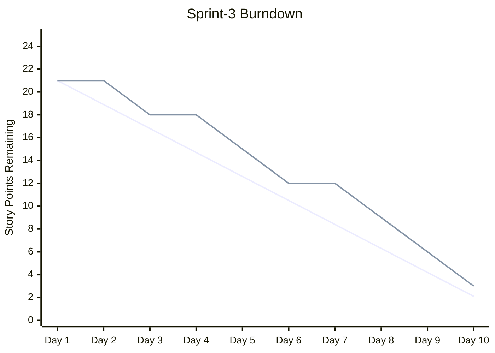

# /project:report

## Auftrag

Zentraler Einstiegspunkt für lesende Projektanalysen. Jeder Unterbefehl wandelt Backlog- und Sprint-Daten in einen Bericht um: ein Burndown-Diagramm, ein Metrik-Dashboard oder einen Abhängigkeitsgraphen (optional mit kritischem Pfad).

## Verwendung

| Aufruf | Funktion | Ersetzt |
|--------|----------|---------|
| `/project:report burndown` | Mermaid-Burndown-Diagramm + Abweichung und Prognose | `/project:report burndown` |
| `/project:report metrics` | Dashboard zu Velocity, Spec-Abdeckung, Gates, Sprint-Gesundheit, Regression | `/project:report metrics` |
| `/project:report deps` | Abhängigkeitsgraph der Stories, Engpässe, parallele Gruppen | `/project:report deps` |
| `/project:report deps --critical` | Kritischer Pfad, Puffer und paralleler Ausführungsplan | `/project:report deps --critical` |

## Argumente

`$ARGUMENTS` auswerten: Das erste Positionswort ist der Unterbefehl (`burndown`, `metrics` oder `deps`). Fehlt er oder ist er unbekannt, die obige Tabelle anzeigen und nachfragen, welcher ausgeführt werden soll.

| Option | Gilt für | Beschreibung |
|--------|---------|--------------|
| `--sprint=Sprint-N` | alle | Zu analysierender Sprint (Standard: aktueller Sprint) |
| `--type=points\|stories\|tasks` | burndown | Einheit des Diagramms (Standard `points`) |
| `--format=dashboard\|json\|markdown` | metrics | Ausgabeformat (Standard `dashboard`) |
| `--format=mermaid\|table\|json` | deps | Ausgabeformat (Standard `mermaid`) |
| `--output=path` | deps | Ausgabepfad (Standard: stdout) |
| `--critical` | deps | Wechselt zur Analyse des kritischen Pfads |
| `--velocity=N` | deps --critical | Team-Velocity (Punkte pro Sprint) für die Zeitplanschätzung |

## Gemeinsame Regeln

- **Single Source of Truth:** Der STATUS von Stories und Tasks wird ausschließlich aus `.bmad/sprint-status.yaml` gelesen; Markdown-Dateien (`project-management/backlog/`, `tasks/TASK-*.md`) liefern den Inhalt (Titel, Punkte, `Depends on:`), niemals den Status. Die `history`-Einträge speisen das Burndown und die Velocity-Trends.
- Standardpfade: `project-management/` (`prd.md`, `backlog/`, `sprints/sprint-{N}-{slug}/`); Templates in `.claude/templates/project/`.
- Berichte lesen Projektdateien nur; geschrieben werden ausschließlich die Metrik-Snapshots in `.bmad/metrics/`.
- **Der Plan-Modus ist verpflichtend:** Vor der Ausführung den Plan vorschlagen (gelesene Daten, geschriebene Dateien) und die Freigabe abwarten.
- Jeden Bericht mit den wichtigsten Beobachtungen und Empfehlungen abschließen.

## burndown

Voraussetzungen: `.bmad/sprint-status.yaml` mit Sprint-Daten, Start-/Enddatum und geschätzten Story Points.

1. **Laden**: den aktuellen Sprint in `.bmad/sprint-status.yaml` lesen (Daten, zugesagte Punkte, Status-`history` pro Tag) sowie frühere Daten aus `.bmad/metrics/`.
2. **Berechnen**: Ideallinie (linear von der Summe auf 0), tatsächlicher Rest pro Tag, Abweichung (voraus/im Rückstand), prognostiziertes Ende anhand der aktuellen Velocity.
3. **Diagramm** (Mermaid):



4. **Analysebericht**:

```
SPRINT-BURNDOWN-BERICHT — Sprint-3 | Tag 9/10
Zugesagt gesamt: 21 Pkt | Verbleibend: 3 | Erledigt: 18 (86%)
Ideal-Rest: 2.1 | Ist: 3 | Abweichung: -0.9 Pkt (leicht im Rückstand)
Durchschnittliche Velocity: 2.0 Pkt/Tag | Prognostiziertes Ende: Tag 10.5 (0.5 Tage Verzug)
Trend: Tage 1-3: 3Pkt (langsamer Start) | Tage 4-6: 6Pkt | Tage 7-9: 9Pkt
Risiko: 1 Story könnte überlaufen (US-015, 3Pkt, blockiert)
```

5. **Speichern**: die Tagesdaten an `.bmad/metrics/burndown-{sprint-id}.json` anhängen.

## metrics

Voraussetzungen: `.bmad/sprint-status.yaml`; `project-management/backlog/` mit Stories; optional die Historie `.bmad/metrics/` und `project-management/prd.md` für die Abdeckung.

| Kategorie | Metriken (Quelle) |
|-----------|-------------------|
| Velocity | Erledigte Punkte pro Sprint, gleitender Durchschnitt (letzte 3), Commitment-Quote (erledigt / zugesagt, Ziel > 80%), Übertrag (`sprint-status.yaml`, Metrik-Historie) |
| Spec-Abdeckung | % der FR-xxx durch Stories abgedeckt, % der Stories mit Code-Referenzen, % der AC mit Tests, % vollständiger Ketten FR→US→Code→Test (PRD, Stories, `/project:trace`) |
| Quality Gates | PRD-Gate (>= 80%), Story-DoD, Erfolgsquote Sprint Ready, Erfolgsquote im ersten Durchlauf (Gate-Historie aus `/gate:check`) |
| Sprint-Gesundheit | Erledigte Stories und Tasks / gesamt, blockierte Stories, TDD-Konformität (`sprint-status.yaml`) |
| Regression | Gefundene / behobene Bugs pro Sprint, Regressionsrate, Escape-Rate (QA-Recette-Sitzungen, Regressionsregister) |

Ablauf:
1. **Sammeln**: `.bmad/sprint-status.yaml`, `.bmad/metrics/`, Traceability-Daten (`/project:trace`), Gate-Historie und QA-Recette-Sitzungen (falls vorhanden) lesen.
2. **Berechnen**: alle fünf Kategorien sowie Trends gegenüber dem Vorsprint (steigend / fallend / gleich).
3. **Dashboard** (eine Zeile pro Metrik mit Statussymbolen, Schwellenwerte wie oben):

```
PROJEKT-METRIK-DASHBOARD — Sprint-3 | 2026-02-19
VELOCITY      Aktuell 18/21 Pkt (86%) | Durchschnitt 19 Pkt/Sprint | Commitment 86% OK | Übertrag 3 Pkt
ABDECKUNG     Anforderungen 12/15 (80%) WARN | Stories mit Code 8/10 | AC mit Tests 24/28 (86%) OK | Vollständige Ketten 7/10 (70%) WARN
QUALITY GATES PRD 1/1 | Story-DoD 6/8 (75%) WARN | Sprint Ready 1/1 | Erster Durchlauf 70% WARN
SPRINT-HEALTH Stories 6/8 | Tasks 22/28 | Blockiert 1 (US-015) WARN | TDD-Konformität 100%
REGRESSION    Bugs gefunden 4 | behoben 3 | Regressionen 0 | Escape-Rate 0%
TRENDS        Velocity +2 Pkt | Abdeckung +10% | Erster Durchlauf -5% | Blockiert gleich
```

4. **Speichern** des Snapshots in `.bmad/metrics/sprint-{id}.json` mit den Schlüsseln `sprint_id`, `date`, `velocity` (`completed`, `committed`, `ratio`), `coverage` (`requirements`, `stories`, `tests`, `traceability`), `gates` (`prd_pass_rate`, `story_pass_rate`, `sprint_ready_rate`, `first_pass_rate`), `health` (`stories_done`, `stories_total`, `tasks_done`, `tasks_total`, `blocked`, `tdd_compliance`), `regression` (`bugs_found`, `bugs_fixed`, `regressions`, `escape_rate`).

`--format=json` oder `markdown` gibt dieselben Daten in diesem Format aus.

## deps

Voraussetzungen: Stories in `project-management/backlog/` mit `Depends on:`-Feldern; optional `.bmad/sprint-status.yaml` (Statusfarben) und `project-management/prd.md` (Gruppierung nach Epic).

1. **Laden**: `project-management/backlog/` durchsuchen, bei `--sprint` filtern, `Depends on:` aus der Traceability-Sektion jeder Story lesen und die Adjazenzliste aufbauen. Der Status stammt aus `.bmad/sprint-status.yaml`.
2. **Validieren**: zirkuläre Abhängigkeiten (A -> B -> C -> A), Verweise auf nicht existierende Stories, Selbstreferenzen. Jedes Problem melden.
3. **Graph** (Mermaid `graph TD`, Standard): ein `subgraph` pro Epic (`EPIC-001: Authentication`), Knoten `US-001[US-001: Login Page]`, Kanten `US-002 --> US-001` (hängt ab von) und `classDef`-Farben nach Status: `done` #90EE90, `inProgress` #FFD700, `blocked` #FF6B6B, `ready` #87CEEB. `--format=table|json` für andere Ausgaben.
4. **Analysieren**: Engpass-Stories (blockieren 3 oder mehr andere), unabhängige Stories, längste Abhängigkeitskette, parallele Gruppen.
5. **Bericht**:

```
STORY-ABHÄNGIGKEITSGRAPH — Sprint-3 | Stories: 8 | Abhängigkeiten: 5
Engpässe: US-001 Login Page (blockiert 4 Stories)
Unabhängig: US-006, US-007
Längste Kette (3 Schritte): US-001 -> US-002 -> US-003
Parallele Gruppen: [US-006, US-007] | [US-004, US-005] (nach US-001)
Probleme: keine zirkulären Abhängigkeiten, keine fehlenden Verweise
```

### deps --critical

Benötigt zusätzlich Story Points. Der kritische Pfad ist die längste Folge abhängiger Stories; er bestimmt die Mindestdauer unabhängig von der Teamgröße.

1. **DAG aufbauen** aus dem obigen Graphen (bei einem Zyklus abbrechen).
2. **Berechnen**: topologische Sortierung, frühester/spätester Start und Ende pro Story, Stories ohne Puffer = kritischer Pfad, Punktesumme entlang des Pfads.
3. **Puffer**: Gesamtpuffer der nicht kritischen Stories, nahezu kritische Pfade (Puffer < 2 Pkt), Stories, die bei Verzögerung kritisch werden könnten.
4. **Zeitplan** (mit `--velocity` die Phasen auf Sprints verteilen):

```
ANALYSE DES KRITISCHEN PFADS — Sprint-3 | Velocity: 21 Pkt/Sprint
Kritischer Pfad (13 Pkt): US-001 (5) -> US-002 (3) -> US-005 (5)
Nahezu kritisch: US-001 (5) -> US-004 (3) [Puffer: 2Pkt]
Phase 1: US-001 + US-006 + US-007 (8Pkt) | Phase 2: US-002 + US-004 (6Pkt) | Phase 3: US-003 + US-005 (7Pkt)
Puffer: US-003 5Pkt | US-004 2Pkt (beobachten) | US-006, US-007 8Pkt
```

5. **Empfehlungen**: optimale Ausführungsreihenfolge, Parallelisierung, Risiken bei kritischen Stories (z. B. den erfahrensten Entwickler US-001 zuweisen), Möglichkeiten zur Verkürzung des Pfads (Stories aufteilen).

## Beispiel

```
User: /project:report deps --critical --sprint=Sprint-3 --velocity=21

Claude: Kritischer Pfad: US-001 -> US-002 -> US-005 (13 Pkt), passt in 1 Sprint.
Risiko: Ein Verzug von 2 oder mehr Tagen bei US-001 gefährdet den gesamten Sprint.
```

## Verwandte Befehle

- `/project:trace` — Traceability-Matrix und Abdeckung
- `/workflow:status` — Übersicht über den Sprint-Status
- `/project:backlog next story` — Nächste Story (berücksichtigt Abhängigkeiten)
- `/workflow:retro` — Sprint-Retrospektive (nutzt die Metriken)
