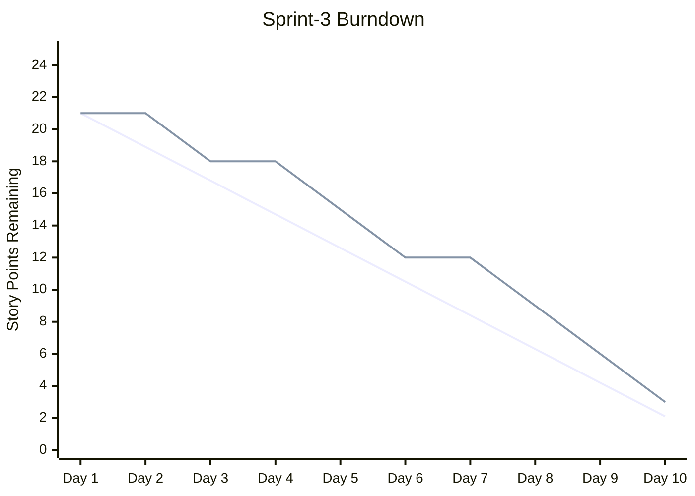

# /project:report

## Mission

Single entry point for read-only project analytics. Each subcommand turns the backlog and sprint data into a report: a burndown chart, a metrics dashboard, or a dependency graph (with optional critical path).

## Usage

| Invocation | What it does | Replaces |
|------------|--------------|----------|
| `/project:report burndown` | Mermaid burndown chart + variance and projection | `/project:report burndown` |
| `/project:report metrics` | Velocity, spec coverage, gates, health, regression dashboard | `/project:report metrics` |
| `/project:report deps` | Story dependency graph, bottlenecks, parallel groups | `/project:report deps` |
| `/project:report deps --critical` | Critical path, slack and parallel execution plan | `/project:report deps --critical` |

## Arguments

Parse `$ARGUMENTS`: the first positional word is the subcommand (`burndown`, `metrics` or `deps`). If missing or unknown, list the table above and ask which one to run.

| Flag | Applies to | Description |
|------|-----------|-------------|
| `--sprint=Sprint-N` | all | Sprint to analyze (default: current sprint) |
| `--type=points\|stories\|tasks` | burndown | Unit of the chart (default `points`) |
| `--format=dashboard\|json\|markdown` | metrics | Output format (default `dashboard`) |
| `--format=mermaid\|table\|json` | deps | Output format (default `mermaid`) |
| `--output=path` | deps | Output path (default stdout) |
| `--critical` | deps | Switch to critical-path analysis |
| `--velocity=N` | deps --critical | Team velocity (points per sprint) for the timeline |

## Shared rules

- **Single source of truth:** story and task STATUS is read from `.bmad/sprint-status.yaml` only; markdown files (`project-management/backlog/`, `tasks/TASK-*.md`) provide content (titles, points, `Depends on:`), never status. Its `history` entries feed the burndown and the velocity trends.
- Default paths: `project-management/` (`prd.md`, `backlog/`, `sprints/sprint-{N}-{slug}/`); templates in `.claude/templates/project/`.
- Reports are read-only for project files; the only writes are the metrics snapshots in `.bmad/metrics/`.
- **Plan mode is mandatory:** before executing, propose the plan (data read, files written) and wait for validation.
- End each report with key observations and recommendations.

## burndown

Prerequisites: `.bmad/sprint-status.yaml` with sprint data, start/end dates and estimated story points.

1. **Load**: read the current sprint in `.bmad/sprint-status.yaml` (dates, committed points, status `history` per day) and past data from `.bmad/metrics/`.
2. **Calculate**: ideal line (linear from total to 0), actual remaining per day, variance (ahead/behind), projected finish from current velocity.
3. **Chart** (Mermaid):



4. **Analysis report**:

```
SPRINT BURNDOWN REPORT — Sprint-3 | Day 9/10
Total committed: 21 pts | Remaining: 3 | Completed: 18 (86%)
Ideal remaining: 2.1 | Actual: 3 | Variance: -0.9 pts (slightly behind)
Average velocity: 2.0 pts/day | Projected finish: Day 10.5 (0.5 days late)
Completion trend: Day 1-3: 3pts (slow start) | Day 4-6: 6pts | Day 7-9: 9pts
Risk: 1 story may carry over (US-015, 3pts, blocked)
```

5. **Store**: append the daily data to `.bmad/metrics/burndown-{sprint-id}.json`.

## metrics

Prerequisites: `.bmad/sprint-status.yaml`; `project-management/backlog/` with stories; optional `.bmad/metrics/` history and `project-management/prd.md` for coverage.

| Category | Metrics (source) |
|----------|------------------|
| Velocity | Points completed per sprint, rolling average (last 3), commitment ratio (completed / committed, target > 80%), carryover (`sprint-status.yaml`, metrics history) |
| Spec coverage | % FR-xxx covered by stories, % stories with code references, % ACs with tests, % complete FR→US→Code→Test chains (PRD, stories, `/project:trace`) |
| Quality gates | PRD gate (>= 80%), story DoD, sprint ready pass rates, first-pass rate (gate history from `/gate:check`) |
| Sprint health | Stories and tasks done / total, blocked stories, TDD compliance (`sprint-status.yaml`) |
| Regression | Bugs found / fixed per sprint, regression rate, escape rate (QA recette sessions, regression registry) |

Process:
1. **Collect**: read `.bmad/sprint-status.yaml`, `.bmad/metrics/`, trace data (`/project:trace`), gate history and QA recette sessions (if present).
2. **Calculate**: all five categories plus trends versus the previous sprint (up / down / same).
3. **Dashboard** (one line per metric with status icons, thresholds as above):

```
PROJECT METRICS DASHBOARD — Sprint-3 | 2026-02-19
VELOCITY      Current 18/21 pts (86%) | Average 19 pts/sprint | Commitment 86% OK | Carryover 3 pts
SPEC COVERAGE Requirements 12/15 (80%) WARN | Stories with code 8/10 | ACs with tests 24/28 (86%) OK | Full chains 7/10 (70%) WARN
QUALITY GATES PRD 1/1 | Story DoD 6/8 (75%) WARN | Sprint ready 1/1 | First-pass 70% WARN
SPRINT HEALTH Stories 6/8 | Tasks 22/28 | Blocked 1 (US-015) WARN | TDD compliance 100%
REGRESSION    Bugs found 4 | fixed 3 | Regressions 0 | Escape rate 0%
TRENDS        Velocity +2 pts | Spec coverage +10% | First-pass -5% | Blocked same
```

4. **Store** the snapshot in `.bmad/metrics/sprint-{id}.json`, with the keys `sprint_id`, `date`, `velocity` (`completed`, `committed`, `ratio`), `coverage` (`requirements`, `stories`, `tests`, `traceability`), `gates` (`prd_pass_rate`, `story_pass_rate`, `sprint_ready_rate`, `first_pass_rate`), `health` (`stories_done`, `stories_total`, `tasks_done`, `tasks_total`, `blocked`, `tdd_compliance`), `regression` (`bugs_found`, `bugs_fixed`, `regressions`, `escape_rate`).

`--format=json` or `markdown` outputs the same data in that format.

## deps

Prerequisites: `project-management/backlog/` stories with `Depends on:` fields; optional `.bmad/sprint-status.yaml` (status colors) and `project-management/prd.md` (epic grouping).

1. **Load**: scan `project-management/backlog/`, filter by `--sprint` if given, read `Depends on:` from each Traceability section, build the adjacency list. Status comes from `.bmad/sprint-status.yaml`.
2. **Validate**: circular dependencies (A -> B -> C -> A), references to non-existent stories, self-references. Report every issue.
3. **Graph** (Mermaid `graph TD`, default): one `subgraph` per epic (`EPIC-001: Authentication`), nodes `US-001[US-001: Login Page]`, edges `US-002 --> US-001` (depends on), and `classDef` colors by status: `done` #90EE90, `inProgress` #FFD700, `blocked` #FF6B6B, `ready` #87CEEB. `--format=table|json` for other outputs.
4. **Analyze**: bottleneck stories (block 3+ others), independent stories, longest dependency chain, parallel groups.
5. **Report**:

```
STORY DEPENDENCY GRAPH — Sprint-3 | Stories: 8 | Dependencies: 5
Bottlenecks: US-001 Login Page (blocks 4 stories)
Independent: US-006, US-007
Longest chain (3 steps): US-001 -> US-002 -> US-003
Parallel groups: [US-006, US-007] | [US-004, US-005] (after US-001)
Issues: no circular dependencies, no missing references
```

### deps --critical

Also requires story points. The critical path is the longest sequence of dependent stories; it sets the minimum duration regardless of team size.

1. **Build the DAG** from the graph above (stop if a cycle exists).
2. **Calculate**: topological sort, earliest/latest start and finish per story, zero-slack stories = critical path, points summed along it.
3. **Slack**: total slack of non-critical stories, near-critical paths (slack < 2 pts), stories that could become critical if delayed.
4. **Timeline** (use `--velocity` to fit phases into sprints):

```
CRITICAL PATH ANALYSIS — Sprint-3 | Velocity: 21 pts/sprint
Critical path (13 pts): US-001 (5) -> US-002 (3) -> US-005 (5)
Near-critical: US-001 (5) -> US-004 (3) [slack: 2pts]
Phase 1: US-001 + US-006 + US-007 (8pts) | Phase 2: US-002 + US-004 (6pts) | Phase 3: US-003 + US-005 (7pts)
Slack: US-003 5pts | US-004 2pts (monitor) | US-006, US-007 8pts
```

5. **Recommendations**: optimal execution order, parallelization, risk on critical stories (e.g. assign the strongest developer to US-001), ways to shorten the path (split stories).

## Example

```
User: /project:report deps --critical --sprint=Sprint-3 --velocity=21

Claude: Critical path: US-001 -> US-002 -> US-005 (13 pts), fits in 1 sprint.
Risk: a 2+ day delay on US-001 puts the whole sprint at risk.
```

## Related Commands

- `/project:trace` — Traceability matrix and coverage
- `/sprint:status` — Sprint status overview
- `/sprint:next-story` — Next story (considers dependencies)
- `/workflow:retro` — Sprint retrospective (uses metrics)
