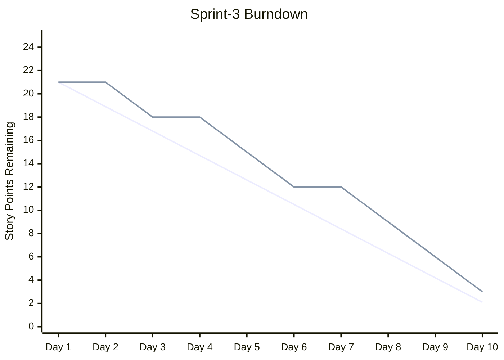

# /project:report

## Misión

Punto de entrada único para los análisis del proyecto de solo lectura. Cada subcomando convierte los datos del backlog y del sprint en un informe: un gráfico burndown, un panel de métricas o un grafo de dependencias (con ruta crítica opcional).

## Uso

| Invocación | Qué hace | Reemplaza |
|------------|----------|-----------|
| `/project:report burndown` | Gráfico burndown Mermaid + desviación y proyección | `/project:report burndown` |
| `/project:report metrics` | Panel de velocidad, cobertura de specs, gates, salud y regresión | `/project:report metrics` |
| `/project:report deps` | Grafo de dependencias de historias, cuellos de botella, grupos paralelos | `/project:report deps` |
| `/project:report deps --critical` | Ruta crítica, holgura y plan de ejecución en paralelo | `/project:report deps --critical` |

## Argumentos

Analizar `$ARGUMENTS`: la primera palabra posicional es el subcomando (`burndown`, `metrics` o `deps`). Si falta o es desconocido, mostrar la tabla anterior y preguntar cuál ejecutar.

| Opción | Aplica a | Descripción |
|--------|---------|-------------|
| `--sprint=Sprint-N` | todos | Sprint a analizar (por defecto: sprint actual) |
| `--type=points\|stories\|tasks` | burndown | Unidad del gráfico (por defecto `points`) |
| `--format=dashboard\|json\|markdown` | metrics | Formato de salida (por defecto `dashboard`) |
| `--format=mermaid\|table\|json` | deps | Formato de salida (por defecto `mermaid`) |
| `--output=path` | deps | Ruta de salida (por defecto: stdout) |
| `--critical` | deps | Cambia al análisis de ruta crítica |
| `--velocity=N` | deps --critical | Velocidad del equipo (puntos por sprint) para estimar el calendario |

## Reglas comunes

- **Fuente única de verdad:** el ESTADO de historias y tareas se lee únicamente de `.bmad/sprint-status.yaml`; los archivos markdown (`project-management/backlog/`, `tasks/TASK-*.md`) aportan el contenido (títulos, puntos, `Depends on:`), nunca el estado. Sus entradas `history` alimentan el burndown y las tendencias de velocidad.
- Rutas por defecto: `project-management/` (`prd.md`, `backlog/`, `sprints/sprint-{N}-{slug}/`); plantillas en `.claude/templates/project/`.
- Los informes son de solo lectura sobre los archivos del proyecto; las únicas escrituras son las instantáneas de métricas en `.bmad/metrics/`.
- **El modo plan es obligatorio:** antes de ejecutar, proponer el plan (datos leídos, archivos escritos) y esperar la validación.
- Terminar cada informe con las observaciones clave y recomendaciones.

## burndown

Requisitos: `.bmad/sprint-status.yaml` con datos del sprint, fechas de inicio/fin y story points estimados.

1. **Cargar**: leer el sprint actual en `.bmad/sprint-status.yaml` (fechas, puntos comprometidos, `history` de estados por día) y los datos pasados de `.bmad/metrics/`.
2. **Calcular**: línea ideal (lineal del total a 0), restante real por día, desviación (adelantado/atrasado), fecha de fin proyectada según la velocidad actual.
3. **Gráfico** (Mermaid):



4. **Informe de análisis**:

```
INFORME BURNDOWN DEL SPRINT — Sprint-3 | Día 9/10
Total comprometido: 21 pts | Restante: 3 | Completado: 18 (86%)
Restante ideal: 2.1 | Real: 3 | Desviación: -0.9 pts (ligeramente atrasado)
Velocidad media: 2.0 pts/día | Fin proyectado: día 10.5 (0.5 días de retraso)
Tendencia: días 1-3: 3pts (inicio lento) | días 4-6: 6pts | días 7-9: 9pts
Riesgo: 1 historia puede pasar al siguiente sprint (US-015, 3pts, bloqueada)
```

5. **Almacenar**: añadir los datos diarios a `.bmad/metrics/burndown-{sprint-id}.json`.

## metrics

Requisitos: `.bmad/sprint-status.yaml`; `project-management/backlog/` con historias; opcionalmente el historial `.bmad/metrics/` y `project-management/prd.md` para la cobertura.

| Categoría | Métricas (fuente) |
|-----------|-------------------|
| Velocidad | Puntos completados por sprint, media móvil (últimos 3), ratio de compromiso (completados / comprometidos, objetivo > 80%), arrastre (`sprint-status.yaml`, historial de métricas) |
| Cobertura de specs | % de FR-xxx cubiertos por historias, % de historias con referencias al código, % de AC con tests, % de cadenas completas FR→US→Code→Test (PRD, historias, `/project:trace`) |
| Quality gates | Gate PRD (>= 80%), DoD de historias, tasa de éxito sprint ready, tasa de éxito a la primera (historial de gates de `/gate:check`) |
| Salud del sprint | Historias y tareas terminadas / total, historias bloqueadas, cumplimiento TDD (`sprint-status.yaml`) |
| Regresión | Bugs encontrados / corregidos por sprint, tasa de regresión, tasa de escape (sesiones QA recette, registro de regresión) |

Proceso:
1. **Recopilar**: leer `.bmad/sprint-status.yaml`, `.bmad/metrics/`, los datos de trazabilidad (`/project:trace`), el historial de gates y las sesiones QA recette (si existen).
2. **Calcular**: las cinco categorías y las tendencias respecto al sprint anterior (sube / baja / igual).
3. **Panel** (una línea por métrica con iconos de estado, umbrales como arriba):

```
PANEL DE MÉTRICAS DEL PROYECTO — Sprint-3 | 2026-02-19
VELOCIDAD     Actual 18/21 pts (86%) | Media 19 pts/sprint | Compromiso 86% OK | Arrastre 3 pts
COBERTURA     Requisitos 12/15 (80%) WARN | Historias con código 8/10 | AC con tests 24/28 (86%) OK | Cadenas completas 7/10 (70%) WARN
QUALITY GATES PRD 1/1 | DoD historia 6/8 (75%) WARN | Sprint ready 1/1 | A la primera 70% WARN
SALUD SPRINT  Historias 6/8 | Tareas 22/28 | Bloqueadas 1 (US-015) WARN | Cumplimiento TDD 100%
REGRESIÓN     Bugs encontrados 4 | corregidos 3 | Regresiones 0 | Escape 0%
TENDENCIAS    Velocidad +2 pts | Cobertura +10% | A la primera -5% | Bloqueadas igual
```

4. **Almacenar** la instantánea en `.bmad/metrics/sprint-{id}.json`, con las claves `sprint_id`, `date`, `velocity` (`completed`, `committed`, `ratio`), `coverage` (`requirements`, `stories`, `tests`, `traceability`), `gates` (`prd_pass_rate`, `story_pass_rate`, `sprint_ready_rate`, `first_pass_rate`), `health` (`stories_done`, `stories_total`, `tasks_done`, `tasks_total`, `blocked`, `tdd_compliance`), `regression` (`bugs_found`, `bugs_fixed`, `regressions`, `escape_rate`).

`--format=json` o `markdown` genera los mismos datos en ese formato.

## deps

Requisitos: historias de `project-management/backlog/` con campos `Depends on:`; opcionalmente `.bmad/sprint-status.yaml` (colores de estado) y `project-management/prd.md` (agrupación por epic).

1. **Cargar**: recorrer `project-management/backlog/`, filtrar con `--sprint` si se indica, leer `Depends on:` en la sección Traceability de cada historia y construir la lista de adyacencia. El estado proviene de `.bmad/sprint-status.yaml`.
2. **Validar**: dependencias circulares (A -> B -> C -> A), referencias a historias inexistentes, autorreferencias. Informar de cada problema.
3. **Grafo** (Mermaid `graph TD`, por defecto): un `subgraph` por epic (`EPIC-001: Authentication`), nodos `US-001[US-001: Login Page]`, aristas `US-002 --> US-001` (depende de) y colores `classDef` según el estado: `done` #90EE90, `inProgress` #FFD700, `blocked` #FF6B6B, `ready` #87CEEB. `--format=table|json` para otras salidas.
4. **Analizar**: historias cuello de botella (bloquean 3 o más), historias independientes, cadena de dependencias más larga, grupos paralelos.
5. **Informe**:

```
GRAFO DE DEPENDENCIAS — Sprint-3 | Historias: 8 | Dependencias: 5
Cuellos de botella: US-001 Login Page (bloquea 4 historias)
Independientes: US-006, US-007
Cadena más larga (3 pasos): US-001 -> US-002 -> US-003
Grupos paralelos: [US-006, US-007] | [US-004, US-005] (tras US-001)
Problemas: sin dependencias circulares, sin referencias faltantes
```

### deps --critical

Requiere además story points. La ruta crítica es la secuencia más larga de historias dependientes; fija la duración mínima sea cual sea el tamaño del equipo.

1. **Construir el DAG** a partir del grafo anterior (detenerse si hay un ciclo).
2. **Calcular**: orden topológico, inicio/fin más temprano y más tardío por historia, historias con holgura cero = ruta crítica, puntos acumulados a lo largo de la ruta.
3. **Holgura**: holgura total de las historias no críticas, rutas casi críticas (holgura < 2 pts), historias que podrían volverse críticas si se retrasan.
4. **Calendario** (usar `--velocity` para repartir las fases en sprints):

```
ANÁLISIS DE RUTA CRÍTICA — Sprint-3 | Velocidad: 21 pts/sprint
Ruta crítica (13 pts): US-001 (5) -> US-002 (3) -> US-005 (5)
Casi crítica: US-001 (5) -> US-004 (3) [holgura: 2pts]
Fase 1: US-001 + US-006 + US-007 (8pts) | Fase 2: US-002 + US-004 (6pts) | Fase 3: US-003 + US-005 (7pts)
Holgura: US-003 5pts | US-004 2pts (vigilar) | US-006, US-007 8pts
```

5. **Recomendaciones**: orden de ejecución óptimo, paralelización, riesgos en las historias críticas (p. ej. asignar al desarrollador más sólido a US-001), formas de acortar la ruta (dividir historias).

## Ejemplo

```
User: /project:report deps --critical --sprint=Sprint-3 --velocity=21

Claude: Ruta crítica: US-001 -> US-002 -> US-005 (13 pts), cabe en 1 sprint.
Riesgo: un retraso de 2 o más días en US-001 pone en peligro todo el sprint.
```

## Comandos relacionados

- `/project:trace` — Matriz de trazabilidad y cobertura
- `/sprint:status` — Resumen del estado del sprint
- `/sprint:next-story` — Siguiente historia (considera las dependencias)
- `/workflow:retro` — Retrospectiva del sprint (usa las métricas)
