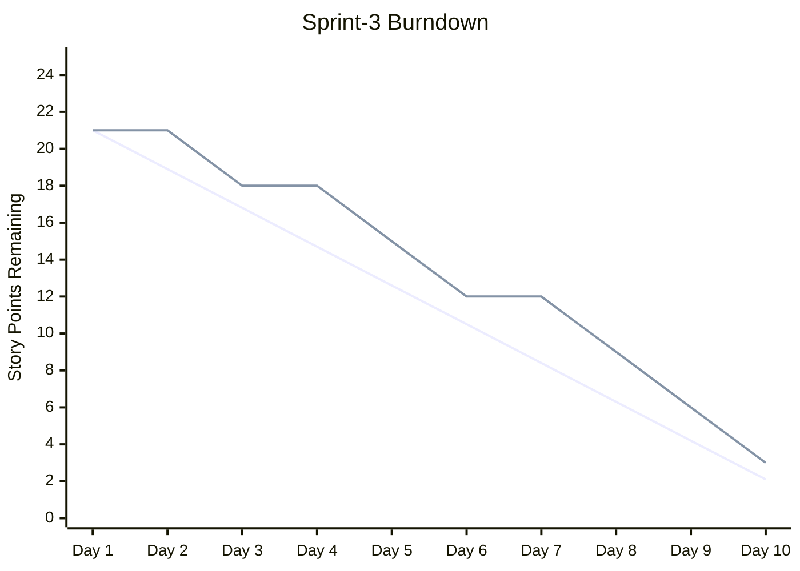

# /project:report

## Mission

Point d'entrée unique pour les analyses de projet en lecture seule. Chaque sous-commande transforme les données du backlog et du sprint en rapport : un graphique burndown, un tableau de bord de métriques, ou un graphe de dépendances (avec chemin critique en option).

## Usage

| Invocation | Action | Remplace |
|------------|--------|----------|
| `/project:report burndown` | Graphique burndown Mermaid + écart et projection | `/project:report burndown` |
| `/project:report metrics` | Tableau de bord vélocité, couverture des specs, gates, santé, régression | `/project:report metrics` |
| `/project:report deps` | Graphe de dépendances des stories, goulots, groupes parallèles | `/project:report deps` |
| `/project:report deps --critical` | Chemin critique, marge et plan d'exécution parallèle | `/project:report deps --critical` |

## Arguments

Analyser `$ARGUMENTS` : le premier mot positionnel est la sous-commande (`burndown`, `metrics` ou `deps`). S'il est absent ou inconnu, afficher le tableau ci-dessus et demander laquelle exécuter.

| Option | S'applique à | Description |
|--------|-------------|-------------|
| `--sprint=Sprint-N` | toutes | Sprint à analyser (par défaut : sprint courant) |
| `--type=points\|stories\|tasks` | burndown | Unité du graphique (défaut `points`) |
| `--format=dashboard\|json\|markdown` | metrics | Format de sortie (défaut `dashboard`) |
| `--format=mermaid\|table\|json` | deps | Format de sortie (défaut `mermaid`) |
| `--output=path` | deps | Chemin de sortie (défaut : stdout) |
| `--critical` | deps | Bascule vers l'analyse du chemin critique |
| `--velocity=N` | deps --critical | Vélocité de l'équipe (points par sprint) pour l'estimation du calendrier |

## Règles communes

- **Source unique de vérité :** le STATUT des stories et tâches est lu uniquement dans `.bmad/sprint-status.yaml` ; les fichiers markdown (`project-management/backlog/`, `tasks/TASK-*.md`) fournissent le contenu (titres, points, `Depends on:`), jamais le statut. Ses entrées `history` alimentent le burndown et les tendances de vélocité.
- Chemins par défaut : `project-management/` (`prd.md`, `backlog/`, `sprints/sprint-{N}-{slug}/`) ; templates dans `.claude/templates/project/`.
- Les rapports sont en lecture seule sur les fichiers du projet ; les seules écritures sont les instantanés de métriques dans `.bmad/metrics/`.
- **Le mode plan est obligatoire :** avant d'exécuter, proposer le plan (données lues, fichiers écrits) et attendre la validation.
- Terminer chaque rapport par les observations clés et des recommandations.

## burndown

Prérequis : `.bmad/sprint-status.yaml` avec les données du sprint, les dates de début/fin et les story points estimés.

1. **Charger** : lire le sprint courant dans `.bmad/sprint-status.yaml` (dates, points engagés, `history` des statuts par jour) et les données passées de `.bmad/metrics/`.
2. **Calculer** : ligne idéale (linéaire du total vers 0), reste à faire réel par jour, écart (en avance/en retard), date de fin projetée selon la vélocité actuelle.
3. **Graphique** (Mermaid) :



4. **Rapport d'analyse** :

```
RAPPORT BURNDOWN DU SPRINT — Sprint-3 | Jour 9/10
Total engagé : 21 pts | Restant : 3 | Terminé : 18 (86%)
Reste idéal : 2.1 | Réel : 3 | Écart : -0.9 pts (légèrement en retard)
Vélocité moyenne : 2.0 pts/jour | Fin projetée : jour 10.5 (0.5 jour de retard)
Tendance : jours 1-3 : 3pts (démarrage lent) | jours 4-6 : 6pts | jours 7-9 : 9pts
Risque : 1 story peut déborder (US-015, 3pts, bloquée)
```

5. **Stocker** : ajouter les données quotidiennes à `.bmad/metrics/burndown-{sprint-id}.json`.

## metrics

Prérequis : `.bmad/sprint-status.yaml` ; `project-management/backlog/` avec des stories ; en option, l'historique `.bmad/metrics/` et `project-management/prd.md` pour la couverture.

| Catégorie | Métriques (source) |
|-----------|--------------------|
| Vélocité | Points terminés par sprint, moyenne glissante (3 derniers), ratio d'engagement (terminés / engagés, cible > 80%), report (`sprint-status.yaml`, historique des métriques) |
| Couverture des specs | % de FR-xxx couverts par des stories, % de stories avec références au code, % d'AC avec tests, % de chaînes complètes FR→US→Code→Test (PRD, stories, `/project:trace`) |
| Quality gates | Gate PRD (>= 80%), DoD des stories, taux de réussite sprint ready, taux de réussite au premier passage (historique des gates de `/gate:check`) |
| Santé du sprint | Stories et tâches terminées / total, stories bloquées, conformité TDD (`sprint-status.yaml`) |
| Régression | Bugs trouvés / corrigés par sprint, taux de régression, taux d'échappement (sessions QA recette, registre de régression) |

Processus :
1. **Collecter** : lire `.bmad/sprint-status.yaml`, `.bmad/metrics/`, les données de traçabilité (`/project:trace`), l'historique des gates et les sessions QA recette (si présentes).
2. **Calculer** : les cinq catégories, plus les tendances par rapport au sprint précédent (hausse / baisse / stable).
3. **Tableau de bord** (une ligne par métrique avec icônes de statut, seuils ci-dessus) :

```
TABLEAU DE BORD DES MÉTRIQUES — Sprint-3 | 2026-02-19
VÉLOCITÉ      Actuel 18/21 pts (86%) | Moyenne 19 pts/sprint | Engagement 86% OK | Report 3 pts
COUVERTURE    Exigences 12/15 (80%) WARN | Stories avec code 8/10 | AC avec tests 24/28 (86%) OK | Chaînes complètes 7/10 (70%) WARN
QUALITY GATES PRD 1/1 | DoD story 6/8 (75%) WARN | Sprint ready 1/1 | Premier passage 70% WARN
SANTÉ SPRINT  Stories 6/8 | Tâches 22/28 | Bloquées 1 (US-015) WARN | Conformité TDD 100%
RÉGRESSION    Bugs trouvés 4 | corrigés 3 | Régressions 0 | Échappement 0%
TENDANCES     Vélocité +2 pts | Couverture +10% | Premier passage -5% | Bloquées stable
```

4. **Stocker** l'instantané dans `.bmad/metrics/sprint-{id}.json`, avec les clés `sprint_id`, `date`, `velocity` (`completed`, `committed`, `ratio`), `coverage` (`requirements`, `stories`, `tests`, `traceability`), `gates` (`prd_pass_rate`, `story_pass_rate`, `sprint_ready_rate`, `first_pass_rate`), `health` (`stories_done`, `stories_total`, `tasks_done`, `tasks_total`, `blocked`, `tdd_compliance`), `regression` (`bugs_found`, `bugs_fixed`, `regressions`, `escape_rate`).

`--format=json` ou `markdown` produit les mêmes données dans ce format.

## deps

Prérequis : stories de `project-management/backlog/` avec des champs `Depends on:` ; en option `.bmad/sprint-status.yaml` (couleurs de statut) et `project-management/prd.md` (regroupement par epic).

1. **Charger** : parcourir `project-management/backlog/`, filtrer avec `--sprint` si fourni, lire `Depends on:` dans la section Traceability de chaque story, construire la liste d'adjacence. Le statut vient de `.bmad/sprint-status.yaml`.
2. **Valider** : dépendances circulaires (A -> B -> C -> A), références à des stories inexistantes, auto-références. Signaler chaque problème.
3. **Graphe** (Mermaid `graph TD`, par défaut) : un `subgraph` par epic (`EPIC-001: Authentication`), nœuds `US-001[US-001: Login Page]`, arêtes `US-002 --> US-001` (dépend de), et couleurs `classDef` selon le statut : `done` #90EE90, `inProgress` #FFD700, `blocked` #FF6B6B, `ready` #87CEEB. `--format=table|json` pour les autres sorties.
4. **Analyser** : stories goulots (bloquent 3 autres ou plus), stories indépendantes, plus longue chaîne de dépendances, groupes parallèles.
5. **Rapport** :

```
GRAPHE DE DÉPENDANCES — Sprint-3 | Stories : 8 | Dépendances : 5
Goulots : US-001 Login Page (bloque 4 stories)
Indépendantes : US-006, US-007
Plus longue chaîne (3 étapes) : US-001 -> US-002 -> US-003
Groupes parallèles : [US-006, US-007] | [US-004, US-005] (après US-001)
Problèmes : aucune dépendance circulaire, aucune référence manquante
```

### deps --critical

Nécessite aussi les story points. Le chemin critique est la plus longue séquence de stories dépendantes ; il fixe la durée minimale quelle que soit la taille de l'équipe.

1. **Construire le DAG** à partir du graphe ci-dessus (s'arrêter en cas de cycle).
2. **Calculer** : tri topologique, début/fin au plus tôt et au plus tard par story, stories à marge nulle = chemin critique, points cumulés le long du chemin.
3. **Marge** : marge totale des stories non critiques, chemins quasi critiques (marge < 2 pts), stories qui pourraient devenir critiques en cas de retard.
4. **Calendrier** (utiliser `--velocity` pour répartir les phases en sprints) :

```
ANALYSE DU CHEMIN CRITIQUE — Sprint-3 | Vélocité : 21 pts/sprint
Chemin critique (13 pts) : US-001 (5) -> US-002 (3) -> US-005 (5)
Quasi critique : US-001 (5) -> US-004 (3) [marge : 2pts]
Phase 1 : US-001 + US-006 + US-007 (8pts) | Phase 2 : US-002 + US-004 (6pts) | Phase 3 : US-003 + US-005 (7pts)
Marge : US-003 5pts | US-004 2pts (à surveiller) | US-006, US-007 8pts
```

5. **Recommandations** : ordre d'exécution optimal, parallélisation, risques sur les stories critiques (p. ex. affecter le développeur le plus expérimenté à US-001), moyens de raccourcir le chemin (découper des stories).

## Exemple

```
User: /project:report deps --critical --sprint=Sprint-3 --velocity=21

Claude: Chemin critique : US-001 -> US-002 -> US-005 (13 pts), tient dans 1 sprint.
Risque : un retard de 2 jours ou plus sur US-001 met tout le sprint en danger.
```

## Commandes associées

- `/project:trace` — Matrice de traçabilité et couverture
- `/sprint:status` — Vue d'ensemble du statut du sprint
- `/sprint:next-story` — Prochaine story (tient compte des dépendances)
- `/workflow:retro` — Rétrospective du sprint (utilise les métriques)
