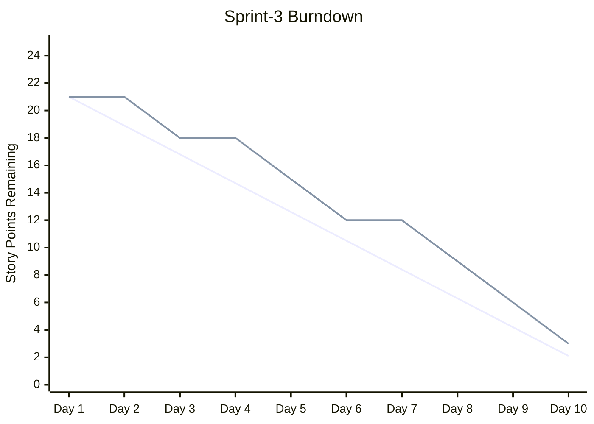

# /project:report

## Missão

Ponto de entrada único para as análises do projeto em modo somente leitura. Cada subcomando transforma os dados do backlog e do sprint em um relatório: um gráfico burndown, um painel de métricas ou um grafo de dependências (com caminho crítico opcional).

## Uso

| Invocação | O que faz | Substitui |
|-----------|-----------|-----------|
| `/project:report burndown` | Gráfico burndown Mermaid + desvio e projeção | `/project:report burndown` |
| `/project:report metrics` | Painel de velocidade, cobertura de specs, gates, saúde e regressão | `/project:report metrics` |
| `/project:report deps` | Grafo de dependências das histórias, gargalos, grupos paralelos | `/project:report deps` |
| `/project:report deps --critical` | Caminho crítico, folga e plano de execução paralela | `/project:report deps --critical` |

## Argumentos

Analisar `$ARGUMENTS`: a primeira palavra posicional é o subcomando (`burndown`, `metrics` ou `deps`). Se estiver ausente ou for desconhecido, exibir a tabela acima e perguntar qual executar.

| Opção | Aplica-se a | Descrição |
|-------|------------|-----------|
| `--sprint=Sprint-N` | todos | Sprint a analisar (padrão: sprint atual) |
| `--type=points\|stories\|tasks` | burndown | Unidade do gráfico (padrão `points`) |
| `--format=dashboard\|json\|markdown` | metrics | Formato de saída (padrão `dashboard`) |
| `--format=mermaid\|table\|json` | deps | Formato de saída (padrão `mermaid`) |
| `--output=path` | deps | Caminho de saída (padrão: stdout) |
| `--critical` | deps | Muda para a análise do caminho crítico |
| `--velocity=N` | deps --critical | Velocidade da equipe (pontos por sprint) para estimar o cronograma |

## Regras comuns

- **Fonte única da verdade:** o STATUS de histórias e tarefas é lido somente de `.bmad/sprint-status.yaml`; os arquivos markdown (`project-management/backlog/`, `tasks/TASK-*.md`) fornecem o conteúdo (títulos, pontos, `Depends on:`), nunca o status. Suas entradas `history` alimentam o burndown e as tendências de velocidade.
- Caminhos padrão: `project-management/` (`prd.md`, `backlog/`, `sprints/sprint-{N}-{slug}/`); templates em `.claude/templates/project/`.
- Os relatórios são somente leitura sobre os arquivos do projeto; as únicas escritas são os instantâneos de métricas em `.bmad/metrics/`.
- **O modo plano é obrigatório:** antes de executar, propor o plano (dados lidos, arquivos escritos) e aguardar a validação.
- Terminar cada relatório com as observações-chave e recomendações.

## burndown

Pré-requisitos: `.bmad/sprint-status.yaml` com dados do sprint, datas de início/fim e story points estimados.

1. **Carregar**: ler o sprint atual em `.bmad/sprint-status.yaml` (datas, pontos comprometidos, `history` de status por dia) e os dados passados de `.bmad/metrics/`.
2. **Calcular**: linha ideal (linear do total até 0), restante real por dia, desvio (adiantado/atrasado), data de término projetada conforme a velocidade atual.
3. **Gráfico** (Mermaid):



4. **Relatório de análise**:

```
RELATÓRIO BURNDOWN DO SPRINT — Sprint-3 | Dia 9/10
Total comprometido: 21 pts | Restante: 3 | Concluído: 18 (86%)
Restante ideal: 2.1 | Real: 3 | Desvio: -0.9 pts (ligeiramente atrasado)
Velocidade média: 2.0 pts/dia | Término projetado: dia 10.5 (0.5 dia de atraso)
Tendência: dias 1-3: 3pts (início lento) | dias 4-6: 6pts | dias 7-9: 9pts
Risco: 1 história pode transbordar (US-015, 3pts, bloqueada)
```

5. **Armazenar**: acrescentar os dados diários a `.bmad/metrics/burndown-{sprint-id}.json`.

## metrics

Pré-requisitos: `.bmad/sprint-status.yaml`; `project-management/backlog/` com histórias; opcionalmente o histórico `.bmad/metrics/` e `project-management/prd.md` para a cobertura.

| Categoria | Métricas (fonte) |
|-----------|------------------|
| Velocidade | Pontos concluídos por sprint, média móvel (últimos 3), taxa de comprometimento (concluídos / comprometidos, meta > 80%), repasse (`sprint-status.yaml`, histórico de métricas) |
| Cobertura de specs | % de FR-xxx cobertos por histórias, % de histórias com referências ao código, % de AC com testes, % de cadeias completas FR→US→Code→Test (PRD, histórias, `/project:trace`) |
| Quality gates | Gate PRD (>= 80%), DoD das histórias, taxa de sucesso sprint ready, taxa de sucesso na primeira tentativa (histórico de gates de `/gate:check`) |
| Saúde do sprint | Histórias e tarefas concluídas / total, histórias bloqueadas, conformidade TDD (`sprint-status.yaml`) |
| Regressão | Bugs encontrados / corrigidos por sprint, taxa de regressão, taxa de escape (sessões QA recette, registro de regressão) |

Processo:
1. **Coletar**: ler `.bmad/sprint-status.yaml`, `.bmad/metrics/`, os dados de rastreabilidade (`/project:trace`), o histórico de gates e as sessões QA recette (se existirem).
2. **Calcular**: as cinco categorias e as tendências em relação ao sprint anterior (alta / queda / igual).
3. **Painel** (uma linha por métrica com ícones de status, limiares como acima):

```
PAINEL DE MÉTRICAS DO PROJETO — Sprint-3 | 2026-02-19
VELOCIDADE    Atual 18/21 pts (86%) | Média 19 pts/sprint | Comprometimento 86% OK | Repasse 3 pts
COBERTURA     Requisitos 12/15 (80%) WARN | Histórias com código 8/10 | AC com testes 24/28 (86%) OK | Cadeias completas 7/10 (70%) WARN
QUALITY GATES PRD 1/1 | DoD história 6/8 (75%) WARN | Sprint ready 1/1 | Primeira tentativa 70% WARN
SAÚDE SPRINT  Histórias 6/8 | Tarefas 22/28 | Bloqueadas 1 (US-015) WARN | Conformidade TDD 100%
REGRESSÃO     Bugs encontrados 4 | corrigidos 3 | Regressões 0 | Escape 0%
TENDÊNCIAS    Velocidade +2 pts | Cobertura +10% | Primeira tentativa -5% | Bloqueadas igual
```

4. **Armazenar** o instantâneo em `.bmad/metrics/sprint-{id}.json`, com as chaves `sprint_id`, `date`, `velocity` (`completed`, `committed`, `ratio`), `coverage` (`requirements`, `stories`, `tests`, `traceability`), `gates` (`prd_pass_rate`, `story_pass_rate`, `sprint_ready_rate`, `first_pass_rate`), `health` (`stories_done`, `stories_total`, `tasks_done`, `tasks_total`, `blocked`, `tdd_compliance`), `regression` (`bugs_found`, `bugs_fixed`, `regressions`, `escape_rate`).

`--format=json` ou `markdown` produz os mesmos dados nesse formato.

## deps

Pré-requisitos: histórias de `project-management/backlog/` com campos `Depends on:`; opcionalmente `.bmad/sprint-status.yaml` (cores de status) e `project-management/prd.md` (agrupamento por epic).

1. **Carregar**: varrer `project-management/backlog/`, filtrar com `--sprint` se informado, ler `Depends on:` na seção Traceability de cada história e construir a lista de adjacência. O status vem de `.bmad/sprint-status.yaml`.
2. **Validar**: dependências circulares (A -> B -> C -> A), referências a histórias inexistentes, autorreferências. Informar cada problema.
3. **Grafo** (Mermaid `graph TD`, padrão): um `subgraph` por epic (`EPIC-001: Authentication`), nós `US-001[US-001: Login Page]`, arestas `US-002 --> US-001` (depende de) e cores `classDef` conforme o status: `done` #90EE90, `inProgress` #FFD700, `blocked` #FF6B6B, `ready` #87CEEB. `--format=table|json` para outras saídas.
4. **Analisar**: histórias gargalo (bloqueiam 3 ou mais), histórias independentes, cadeia de dependências mais longa, grupos paralelos.
5. **Relatório**:

```
GRAFO DE DEPENDÊNCIAS — Sprint-3 | Histórias: 8 | Dependências: 5
Gargalos: US-001 Login Page (bloqueia 4 histórias)
Independentes: US-006, US-007
Cadeia mais longa (3 etapas): US-001 -> US-002 -> US-003
Grupos paralelos: [US-006, US-007] | [US-004, US-005] (após US-001)
Problemas: sem dependências circulares, sem referências ausentes
```

### deps --critical

Exige também story points. O caminho crítico é a mais longa sequência de histórias dependentes; ele define a duração mínima, qualquer que seja o tamanho da equipe.

1. **Construir o DAG** a partir do grafo acima (parar se houver ciclo).
2. **Calcular**: ordenação topológica, início/término mais cedo e mais tarde por história, histórias com folga zero = caminho crítico, pontos somados ao longo do caminho.
3. **Folga**: folga total das histórias não críticas, caminhos quase críticos (folga < 2 pts), histórias que poderiam se tornar críticas se atrasarem.
4. **Cronograma** (usar `--velocity` para distribuir as fases em sprints):

```
ANÁLISE DO CAMINHO CRÍTICO — Sprint-3 | Velocidade: 21 pts/sprint
Caminho crítico (13 pts): US-001 (5) -> US-002 (3) -> US-005 (5)
Quase crítico: US-001 (5) -> US-004 (3) [folga: 2pts]
Fase 1: US-001 + US-006 + US-007 (8pts) | Fase 2: US-002 + US-004 (6pts) | Fase 3: US-003 + US-005 (7pts)
Folga: US-003 5pts | US-004 2pts (monitorar) | US-006, US-007 8pts
```

5. **Recomendações**: ordem de execução ótima, paralelização, riscos nas histórias críticas (p. ex. designar o desenvolvedor mais experiente para US-001), formas de encurtar o caminho (dividir histórias).

## Exemplo

```
User: /project:report deps --critical --sprint=Sprint-3 --velocity=21

Claude: Caminho crítico: US-001 -> US-002 -> US-005 (13 pts), cabe em 1 sprint.
Risco: um atraso de 2 ou mais dias em US-001 coloca todo o sprint em risco.
```

## Comandos relacionados

- `/project:trace` — Matriz de rastreabilidade e cobertura
- `/sprint:status` — Visão geral do status do sprint
- `/sprint:next-story` — Próxima história (considera as dependências)
- `/workflow:retro` — Retrospectiva do sprint (usa as métricas)
